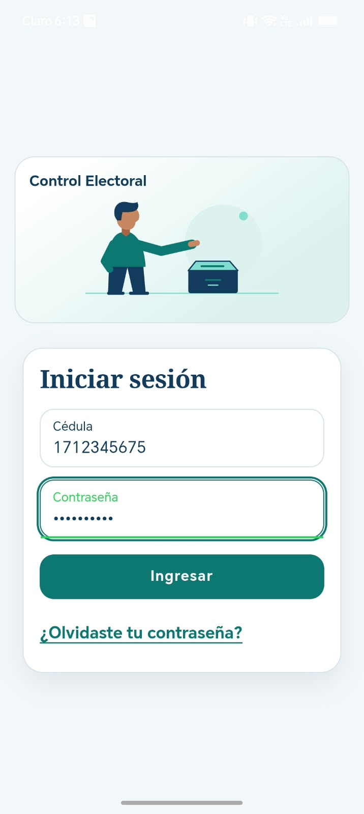
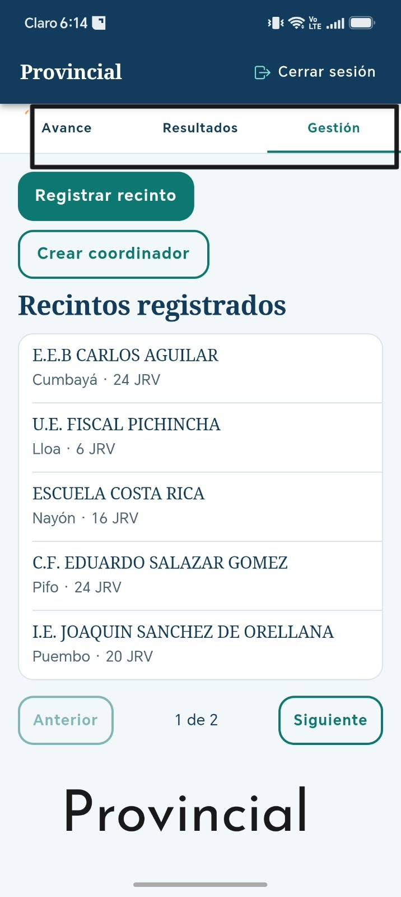
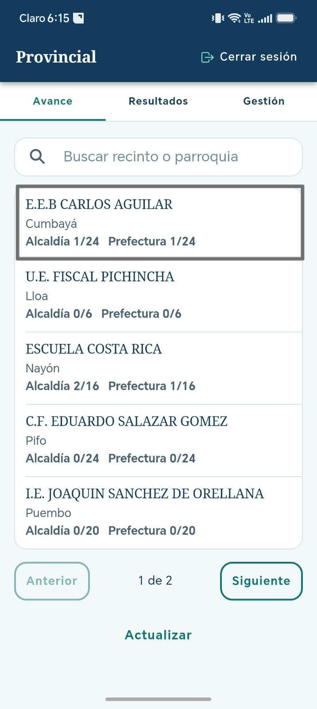
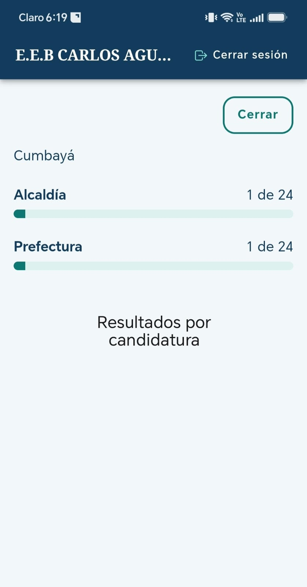
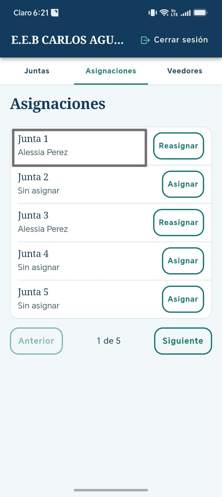
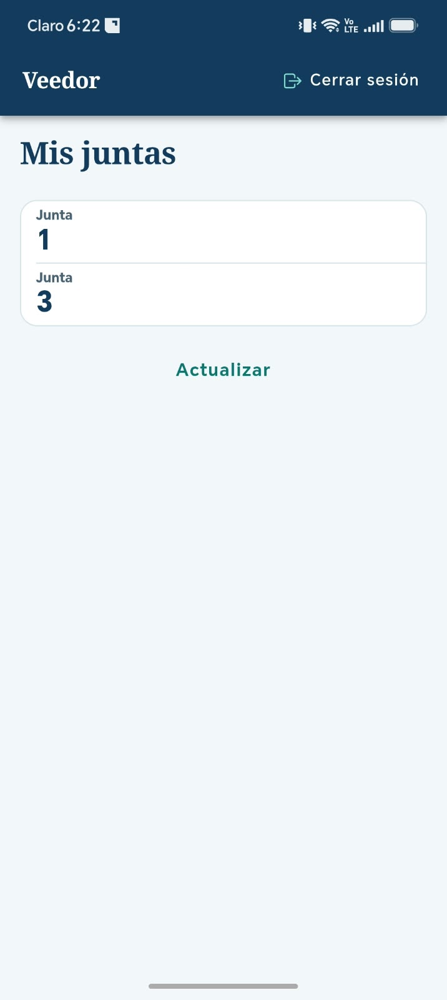
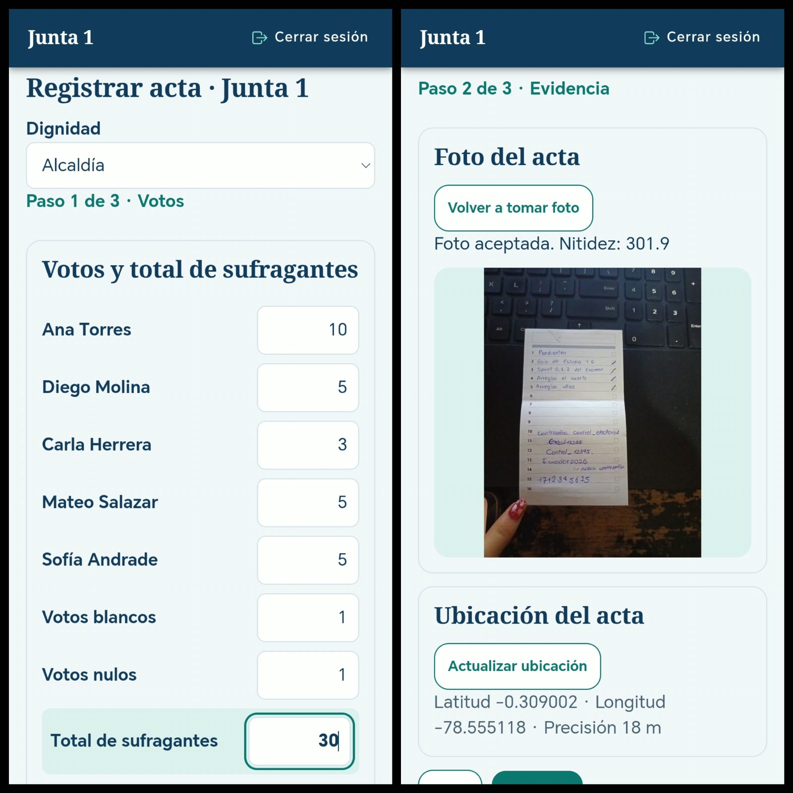
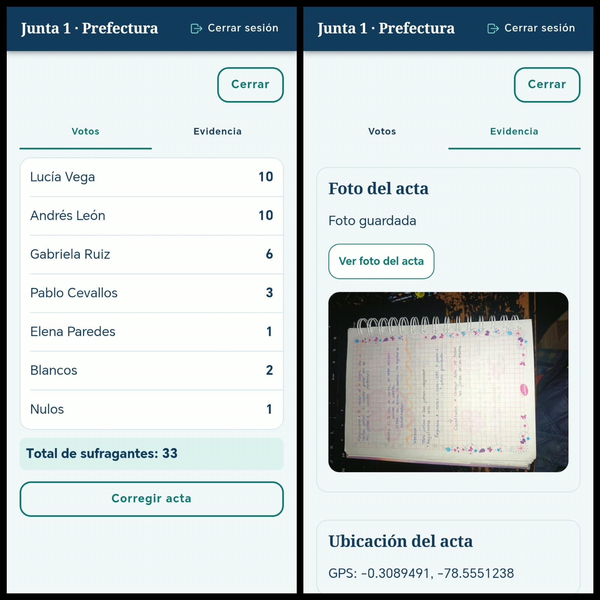
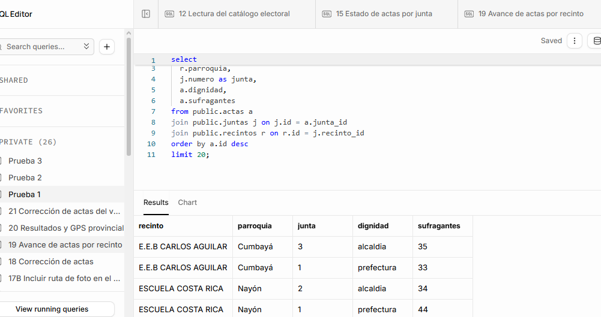

# Control Electoral

Aplicación móvil académica para registrar y consultar actas electorales de Alcaldía y Prefectura. El sistema organiza el trabajo por roles, desde el registro de un recinto y la asignación de sus juntas hasta la consulta de los resultados consolidados.

**Autora:** Ariana Elizabeth Villota Jácome  
**Tecnologías:** Ionic Angular Standalone, Capacitor, Supabase y Brevo

## Cómo funciona

| Rol | Funciones principales |
|---|---|
| Provincial | Registra recintos y crea coordinadores en **Gestión**. Consulta las actas reportadas en **Avance** y revisa los votos por candidatura, por recinto o consolidados, en **Resultados**. |
| Coordinador de recinto | Crea veedores, asigna o reasigna juntas y consulta las actas de su recinto. Puede revisar los votos, abrir la foto, consultar el GPS y corregir el acta. |
| Veedor | Consulta sus juntas asignadas en **Mis juntas**. Registra votos, foto y ubicación. También puede corregir un acta mientras la junta siga asignada a su cuenta. |

### Recorrido de un acta

1. El **provincial** registra un recinto con su nombre, parroquia y cantidad de Juntas Receptoras del Voto (JRV). El sistema genera las juntas según la cantidad indicada.
2. El provincial crea la cuenta del **coordinador** y la vincula al recinto. El coordinador crea la cuenta del **veedor**. Las cuentas nuevas reciben un correo de bienvenida y completan la activación mediante un código y un cambio de contraseña.
3. El coordinador asigna una junta al veedor. La junta aparece en **Mis juntas**.
4. El veedor selecciona **Alcaldía** o **Prefectura**, ingresa los votos de las cinco candidaturas, los blancos, los nulos y el total de sufragantes. La app comprueba que la suma coincida con el total declarado.
5. En Android, el veedor toma la foto del acta y obtiene la ubicación. La app comprueba la nitidez de la imagen. Al guardar, Supabase registra el acta, los votos, las coordenadas y la ruta de la foto.
6. El coordinador puede revisar el detalle del acta. Si se guarda una corrección autorizada, el sistema registra el motivo y conserva los datos anteriores en el historial. El provincial puede consultar los votos vigentes al actualizar los resultados.

**Caso de prueba:** en el recinto **E.E.B. Carlos Aguilar, Cumbayá**, se registró el acta de **Prefectura de la Junta 1 con 33 sufragantes** y el acta de **Alcaldía de la Junta 3 con 35 sufragantes**. El panel provincial muestra un acta reportada por cada dignidad y permite consultar los votos por candidatura al filtrar por recinto.

## Instalación y ejecución

### Requisitos

- Node.js y npm.
- Ionic CLI.
- Android Studio y un dispositivo Android para probar la cámara y el GPS.
- Acceso a un proyecto Supabase configurado para la aplicación.

### Configuración sin secretos

1. Abre una terminal en la carpeta que contiene `package.json` e instala las dependencias:

   ```bash
   npm ci
   ```

2. Copia `src/environments/environment.example.ts` como `src/environments/environment.ts`. Completa la URL base de Supabase y la clave pública de cliente usando los campos del archivo de ejemplo.
3. Para configurar otro proyecto Supabase, revisa el orden de las migraciones en `supabase/migrations/`, las funciones del servidor y la configuración del bucket privado `evidencias-actas` y del correo transaccional.
4. Guarda las credenciales de Brevo y las claves administrativas de Supabase únicamente en la configuración del servidor. Mantén el archivo `environment.ts` fuera del repositorio.

### Ejecutar en el navegador

```bash
ionic serve
```

### Ejecutar en Android

```bash
ionic build
npx cap sync android
npx cap open android
```

Desde Android Studio, selecciona el dispositivo y ejecuta la aplicación. Al probar el registro de un acta, concede los permisos de cámara y ubicación que solicite Android.

## Cuentas de demostración

El acceso se realiza con cédula y contraseña. Para la evaluación se usan cuentas de prueba separadas para los tres roles.

| Cuenta de demostración | Para qué se usa |
|---|---|
| Provincial de prueba | Gestionar recintos y coordinadores y consultar el avance y los resultados. |
| Coordinador de Carlos Aguilar | Crear veedores, asignar juntas y revisar o corregir actas del recinto. |
| Veedor de Carlos Aguilar | Abrir **Mis juntas** y registrar o corregir un acta de una junta asignada. |

Las cédulas y contraseñas de las cuentas de prueba se comparten con el evaluador por el medio privado de entrega. Para iniciar el recorrido de demostración, entra como provincial y después usa las cuentas de coordinador y veedor de **Carlos Aguilar, Cumbayá**.

## Arquitectura y decisiones

La aplicación usa una arquitectura por capas ligera:

- **Presentación:** páginas y componentes de Ionic Angular. Los formularios reactivos validan los campos y las señales de Angular actualizan la interfaz.
- **Aplicación:** servicios que coordinan operaciones como el inicio y el cierre de sesión.
- **Infraestructura:** repositorios y adaptadores que comunican la app con Supabase y con los plugins de cámara y ubicación de Capacitor.
- **Backend:** Supabase Auth gestiona las sesiones. PostgreSQL guarda los datos y aplica controles de acceso por rol y asignación. Supabase Storage guarda las fotos en un bucket privado. Brevo se usa para el correo transaccional.

Las decisiones técnicas del equipo están en el [índice de ADR](docs/adr/README.md).

## Modelo de datos

| Tabla | Qué guarda |
|---|---|
| `perfiles` | Datos del usuario, rol y recinto cuando corresponde. |
| `recintos`, `juntas` | Recintos electorales y sus Juntas Receptoras del Voto. |
| `asignaciones_juntas` | Asignaciones vigentes e historial de asignaciones de veedores por junta. |
| `organizaciones_politicas`, `candidaturas` | Listas y candidaturas de cada dignidad. |
| `actas`, `votos_acta` | Actas por junta y dignidad, votos por candidatura, blancos, nulos, sufragantes y evidencia. |
| `correcciones_acta` | Autor, fecha, motivo y datos anteriores de cada corrección guardada. |

## Pruebas funcionales

| Prueba | Resultado que se verifica |
|---|---|
| Acceso y activación | Cada usuario entra al panel de su rol. Las cuentas nuevas completan la activación y el cambio de contraseña. |
| Asignación y reasignación | La junta aparece en la cuenta del veedor asignado. Al reasignarla y actualizar, desaparece de la cuenta anterior. |
| Registro de acta en Android | La app valida la suma de votos y guarda el acta con la foto aceptada y las coordenadas. |
| Consulta y corrección | El coordinador revisa el acta y las correcciones autorizadas actualizan los votos y quedan en el historial. |
| Avance y resultados provinciales | El avance cuenta las actas reportadas por dignidad. Los resultados muestran los votos vigentes por recinto o en el consolidado. |
| Persistencia en Supabase | Se comprueban los sufragantes, el detalle de votos, la ruta de la foto, las coordenadas y el historial de correcciones. |

## Capturas

### 1. Inicio de sesión

Acceso a la aplicación con cédula y contraseña.



### 2. Gestión provincial

Registro de recintos y creación de coordinadores desde el panel provincial.



### 3. Avance de actas

Actas reportadas de Alcaldía y Prefectura respecto al total de juntas de Carlos Aguilar.



### 4. Resultados por candidatura

Detalle de votos de Prefectura con el filtro del recinto Carlos Aguilar.



### 5. Asignación de juntas

Asignación de la Junta 1 a un veedor activo desde el panel del coordinador.



### 6. Mis juntas

Juntas asignadas al veedor y acciones disponibles para sus actas.



### 7. Acta con foto y GPS

Detalle del acta de **Prefectura de la Junta 1** desde **Coordinador → Juntas → Ver acta de Prefectura → Ver foto del acta**.



### 8. Corrección de acta

Formulario de corrección de votos con el motivo o confirmación del guardado.



### 9. Verificación en Supabase

Consulta del acta de Prefectura de la Junta 1 de Carlos Aguilar con los sufragantes y los datos de foto y ubicación.


